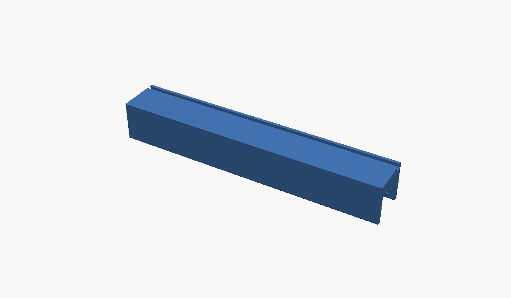
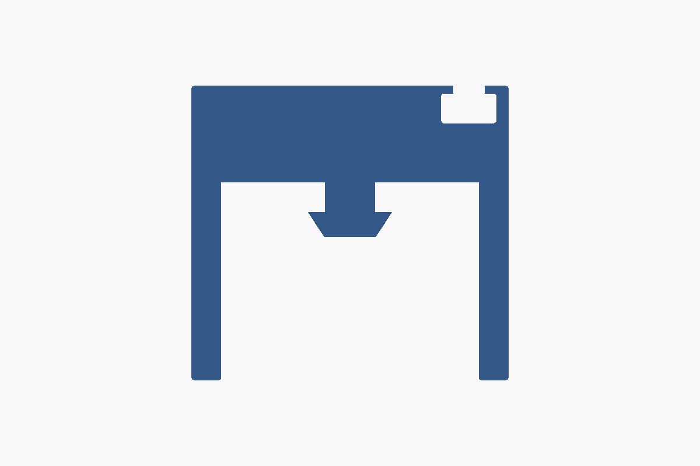
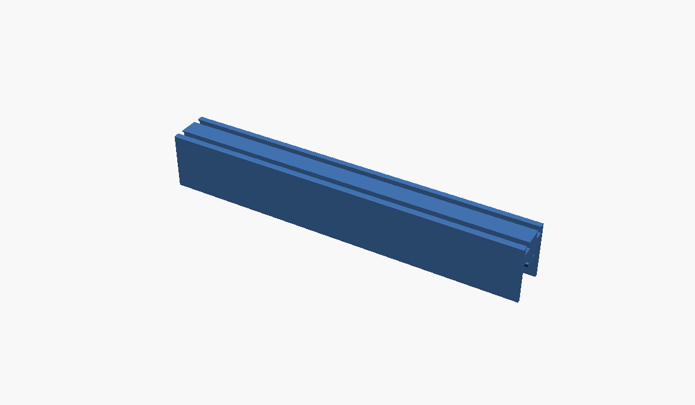
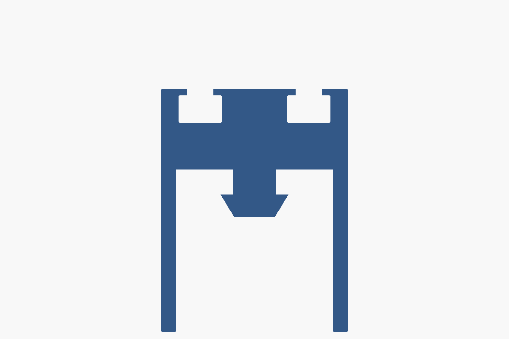
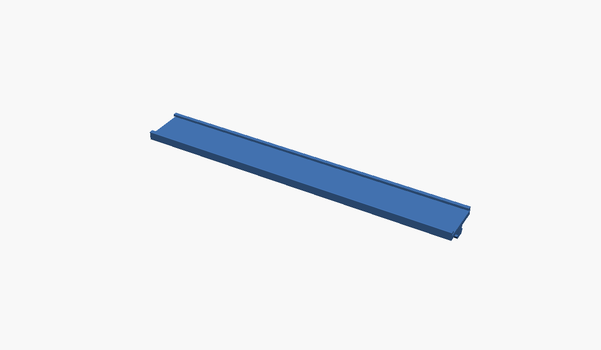
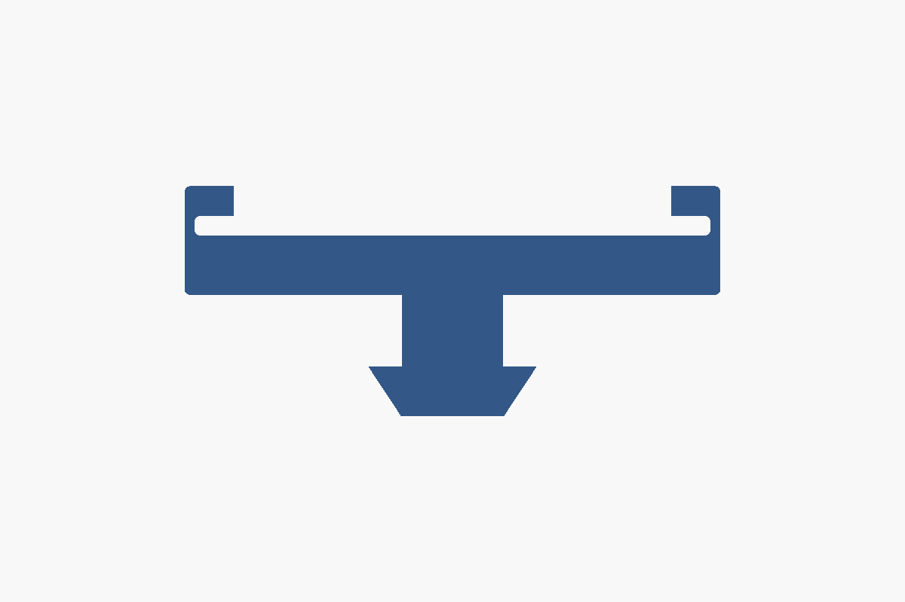
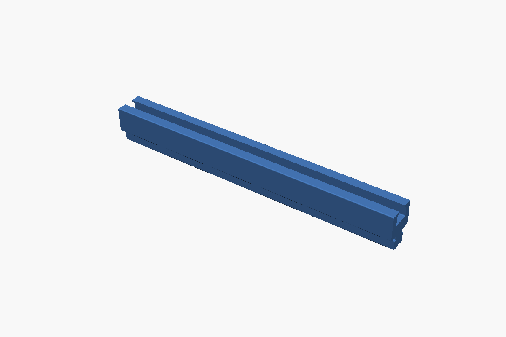

# 2020 extrusion and rail adapters

3D-printed parts that hold Eurorack modules on 2020 aluminium extrusion. Each
part has a captive channel for a Eurorack threaded strip (or a row of M2.5/M3
T-nuts of the same size). The module screws go through a slot in the top of
the part and into the strip.

All parts are OpenSCAD files, except the rail riser, which is a `.3mf` mesh.
The 3D pictures show the parts at 200 mm long. Each `.scad` file sets its
own default `length`; check it before you export.

| File | Part |
|---|---|
| `2020-adapter.scad` | 2020 adapter, one strip channel |
| `2020-adapter-dual-strip.scad` | 2020 adapter, two strip channels |
| `2020-large-channel.scad` | 2020 adapter, one wide channel |
| `rail-riser.3mf` | riser that sits on an existing Eurorack rail |

## 2020 adapter

The adapter wraps the top of the extrusion. A T-tab slides into the slot from
one end, and a side wall hangs down each side face. The walls carry the
load, so the part does not hang from the tab alone. The strip channel sits
12 mm off the centreline (`strip_y_offset`).

- Shelf: 32 mm wide (`body_width`), 9.8 mm above the extrusion face.
- Strip channel: 5.6 × 3.0 mm, with a 3.2 mm access slot for M3. Set
  `access_slot_width = 2.9` for M2.5.
- Side walls: 3 mm thick, 20 mm deep, with 0.2 mm clearance to the
  extrusion. Set `use_side_walls = false` to remove them.
- The tab matches a Misumi-style tapered T-slot. If the tab does not fit your
  extrusion, adjust the `slot_*` values.

Print the part on one end, with the profile facing up, for the most accurate
slot and tab. You can also print it on its back face; the channel lips are a
short overhang and bridge without supports.

## Dual-strip adapter

This adapter has a strip channel on each side of the centreline, at ±7 mm
(`strip_y_offset`). Its profile differs from the single-strip adapter:

- The side walls sit flush with the shelf, so the whole part is one width:
  24.2 mm, 10.4 mm above the extrusion face. The shelf width comes from
  `rail_size`, `wall_clearance` and `wall_thickness`. `body_width` (22 mm)
  applies only when `use_side_walls = false`.
- Side walls: 2 mm thick, 21 mm deep, with 0.1 mm clearance to a 20 mm
  extrusion face.
- Strip channels: 5.6 × 3.6 mm, with 3.4 mm access slots for M3.
- The tab is larger than on the single-strip adapter: 5.8 mm slot opening,
  9.4 mm inner width. Check the fit on a short piece first.

The default `length` in this file is 199 mm.

## Large-channel adapter

A thin, 27 mm wide plate with one wide, shallow cavity across the full top
face. It has a T-tab but no side walls. Use it for flat parts that slide
along the extrusion.

## Rail riser

The riser slides into the strip channel of a standard Eurorack rail and has a
new strip channel on top. Panels then sit 8.4 mm further out than on the bare
rail. Use it to get more depth behind modules that are too deep for the case.

- The mesh is 100 mm long and 10 mm wide.
- The top channel is 5.6 × 3.6 mm, with a 3.4 mm access slot for M3.
- Rails differ between makers. Measure the slot opening and lip thickness of
  your rail before you print.
- In a curved case, the raised panels lean out over the screws of the next,
  unraised row. A screwdriver cannot reach those screws.

Print the riser on its side. The neck, which takes the pull of the module
screws, then has its layers along the load.

## Lengths

The print bed limits each piece to about 100 mm, so print a long rail in
segments. Rail lengths for common case widths (1 HP = 5.08 mm):

- 84 HP: 426.7 mm
- 104 HP: 528.3 mm

## License

MIT. See `LICENSE.md` in this folder.
