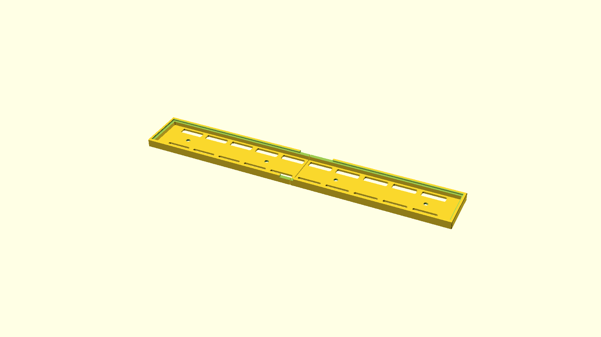

# m-power bus board (eurorack-v2) — hand-solder bus board

The m-power bus board feeds 20 modules from the m-power PSU
(`hardware/m-power`). Each module connects with a 5-pin JST PH cable.
The KiCad project is `eurorack-busboard-v2`.

This is a copy of `hardware/eurorack-busboard` (the single-row board) with
larger SMD footprints, for hand assembly, and JST PH 5-pin power headers
in place of the 16-pin Eurorack headers. It keeps the 4-layer stack, the
20 header slots, and most of the v1 placement and routing.

The board is named "m-power bus" on its silkscreen. It is 389.5 × 54 mm
(v1: 414 × 62 mm).

- Height: the JST header is 8 mm shorter than the 16-pin header, so in
  each slot the header, the −12V PTC, its cap and its via all moved 8 mm
  up. The −12V and GND planes moved with them.
- Length: v2 has no wire-pad input (v1's J23–J26). Power comes in only
  through the two Mini-Fit Jr 2x3 connectors, J21 (top edge) and J22
  (bottom edge). J22 sits directly below J21, in the same column.
- Mounting: four M3 holes, H1–H4, 3.5 mm in from each corner. v1's nine
  holes along the bottom edge and in the power-entry block are gone.

In the power-entry block:

- The three input trunks on B.Cu run from the fuse column to the connector
  column at y = 22.5, 27 and 31.5 mm, between the J21 and J22 pin rows.
- The clamp diodes D2/D3 (SMC) and D5/D6 (SMB) stand vertical in two
  columns right of the bulk caps C42/C43. Each cathode goes to a rail via
  and each anode to a GND via, all in one column at x = 217.5 mm.
- The rail LEDs and their resistors sit below the clamp diodes, one row
  per rail (+12V, +5V, −12V from the top).
- D1 sits below the input fuses; C41 and D4 sit right of J22.
- v1 had a short B.Cu −12V stitch under J22. v2 does not have it; the In2
  −12V plane carries that rail.

## Power input

J21 and J22 are Mini-Fit Jr 2x3 right-angle headers, wired in parallel.
Feed only one of them. Seen into the mating face, with the board below:

| Row | Left | Middle | Right |
|---|---|---|---|
| Top | +12V | GND | +5V |
| Bottom | GND | −12V | GND |

By pad number: 1 = GND, 2 = −12V, 3 = GND, 4 = +5V, 5 = GND, 6 = +12V. The
m-power PSU (`hardware/m-power`, J5) uses the same map, so wire the cable
pin n to pin n. The front silkscreen shows the face view right of J22, as
one KiCad group, "Mini-Fit pinout legend".

## Power headers

Each slot has one JST PH 5-pin vertical header (B5B-PH-K, LCSC C157993).
Cables plug in from the top, as with the 16-pin headers.

| Pin | Rail |
|---|---|
| 1 | −12V (square pad, next to the −12V PTC) |
| 2 | GND |
| 3 | +12V |
| 4 | GND |
| 5 | +5V |

The JST adapters (`hardware/jst-power-adapter`) use the same map from rev B.
A rev A adapter has pins 1 and 3 the other way round, so its cable needs the
wires on pins 1 and 3 crossed at one end.

There is no CV or Gate bus. The 5-pin header carries power only. A JST PH
contact is rated 2A, which is more than the 1.1A PTC on each rail.

The header symbol and footprint come from the shared library:
`maddie:JST_PH_1x05_Vertical` and `maddie:CONN-TH_B5B-PH-K-S-LF-SN`.

## Changes from v1

| Part | v1 | v2 |
|---|---|---|
| 100nF caps, resistors | 0805 | 1206, hand-solder pads (1.8 × 1.8 mm) |
| Rail LEDs | 0805 | 1206, hand-solder pads |
| Per-header +5V PTC | 1206 | 1812, hand-solder pads |
| ±12V and input PTCs | 1812 | 1812, pads 0.6 mm longer |
| Q1 reverse-polarity FET | AO3401A, SOT-23 | AOD4185, DPAK (TO-252) |

The new footprints are in `hardware/lib/maddie.pretty`:
`ER_Chip_1206_HandSolder`, `ER_C_1206_HandSolder`, `ER_LED_1206_HandSolder`,
`ER_PTC_1812_HandSolder`, `ER_TO252_PMOS`. The v1 footprints are unchanged.

Layout changes:

- Each per-header +5V PTC moved 2.6 mm up, so its larger pads clear the
  +12V via of the next PTC.
- Q1 sits above its old place. R1 stands vertical under the gate leg. The
  tracks around them are re-routed.
- D7 moved 0.7 mm left, away from R2.
- The hand-solder footprints use a 0.1 mm courtyard margin across the part,
  not the IPC 0.25 mm. With this margin, a 1812 and a 1206 fit side by side
  as in v1.

## Q1 fix

In v1, Q1's source was on the fused input and its drain on the +5V bus. The
body diode was therefore backwards: a reversed +5V input pulled the bus
negative through it, and only the D3 shunt Schottky stopped it. In v2, the
drain (tab) goes to `P5_FUSED` and the source goes to `+5V`. This is the
correct high-side reverse-polarity layout. The `ER_TO252_PMOS` pad numbers
follow the `ER_PMOS` symbol (1 = G, 2 = S, 3 = D tab), not the JEDEC
pinout.

## Parts

`BOM.csv` lists the LCSC picks, with prices checked on 2026-11-11. The
parts cost about $6.90 for each board. Keep the per-header 1.1A PTCs at 24V
or higher: if a module shorts +12V to −12V, one PTC can see about 24V.

## Silkscreen

- The front silkscreen has only the labels and reference designators.
- Next to each pinout legend ("1:-12V 2:GND …") is a drawing of the JST
  header, numbered 1–5. It has the same orientation as J1–J20: vertical,
  with the square pin 1 at the bottom. Each drawing is one KiCad group,
  "pin-1 diagram".
- Each fuse has an IEC fuse symbol (a box with a line through it) between
  its pads, and each 100nF cap (C1–C40) has a capacitor symbol (two
  plates). The symbols are part of the footprints: `ER_PTC_1812_HandSolder`
  and `ER_C_1206_HandSolder`. The cap footprint is a copy of
  `ER_Chip_1206_HandSolder` with the symbol added, so R1–R4 keep the plain
  footprint. There is no outline box around the fuses: the +5V PTCs sit
  0.3 mm from the pads of the caps next to them.
- The back silkscreen has a pattern: pattern.monster "memphis-4", 2-colour
  export (`pattern.svg`). The shapes are silkscreen; the background is bare
  solder mask. One tile is 30 × 30 mm, so the thinnest wavy line is about
  0.22 mm wide. The pattern is mirrored, so it reads correctly from the back.
- The pattern is cut back 0.4 mm from every through-hole pad, hole and via,
  0.4 mm from the mounting-hole courtyards, and 0.6 mm from the board edge.
  It is one KiCad group, "silk pattern memphis-4 (back)": select the group
  to move or delete the whole pattern.

## Tray

`busboard-tray.scad` is an open tray that holds the board on the face of one
2020 extrusion. It needs BOSL2. The board sits on a ledge that keeps its
through-hole pins off the floor, and a lip covers 1 mm of each board edge.
The rim has notches for J21, J22 and the tall parts next to them.

The board is longer than the print bed, so the tray prints as two halves that
meet at the board centre. Set `part` to `"left"` or `"right"` to export one
half. Print each half floor-down, with no supports. To assemble:

1. Slide the left half onto the left end of the board, under the lips.
2. Slide the right half onto the right end until the halves meet.
3. Put T-nuts into the 2020 slot and screw both halves down (M5 by default,
   `screw_d`).

## Checks (2026-11-11)

- ERC: 0 violations.
- DRC: 0 errors, 0 unconnected, 0 schematic-parity issues. 4
  `text_thickness` warnings remain, on four Comfortaa board texts.
  KiCad cannot measure the stroke of a rounded TrueType font. The text is
  above JLCPCB's 1.0 mm minimum height.